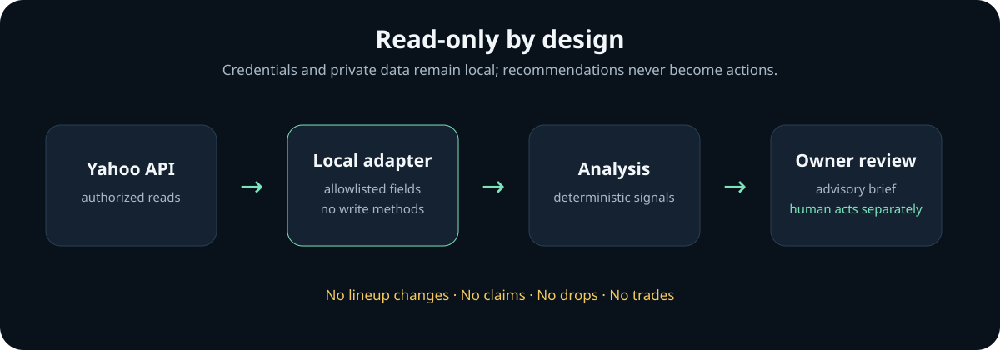

# MCP Fantasy

[](https://github.com/m4rtian/mcp-fantasy/actions/workflows/test.yml)
[](https://www.python.org/)
[](LICENSE)

A privacy-conscious, read-only fantasy football assistant for Yahoo Fantasy Sports.

> **Status:** Milestone 2 includes a tested, deterministic analysis boundary using fictional fixtures. Yahoo API access and its security review are still pending.

**[Open the fictional analysis demo](https://m4rtian.github.io/mcp-fantasy/demo.html)**

## Why this project exists

Fantasy managers often have to compare rosters, matchups, standings, available players, and recent transactions across several screens. MCP Fantasy explores a simpler workflow: give an AI assistant authorized, read-only context and use it to support weekly lineup and waiver decisions.

## Current milestone

The public Python package accepts an already-sanitized fantasy snapshot and produces a deterministic weekly brief. It exposes no transaction, lineup, claim, drop, or trade operation. Tests verify expected recommendations, malformed-input rejection, and that analysis never mutates its input.

```bash
python -m venv .venv
source .venv/bin/activate
python -m pip install -e .
python -m unittest discover -s tests -v
```

The example fixture is fictional and safe to inspect at `examples/fictional_snapshot.json`.

## Architecture



The future Yahoo adapter will be responsible for OAuth, allowlisting fields, and removing direct identifiers before data reaches the analysis layer. The analysis package stays provider-independent and accepts only a small structured snapshot.

## Example interactions

| Input signal | Advisory output |
| --- | --- |
| Healthy player with strong opportunity and matchup | Strong start consideration |
| Player with a non-healthy availability status | Monitor availability |
| Available player with a rising usage trend | Add to waiver watch |

All outputs are observations for owner review—not automated actions.

## Planned capabilities

- Summarize league settings, standings, and weekly matchups
- Review the owner's roster and identify lineup considerations
- Compare available players using relevant statistics
- Surface waiver candidates and explain the tradeoffs
- Review transaction history for additional league context

## Safety boundaries

The planned integration is intentionally narrow:

- **Read-only:** no lineup changes, waiver claims, drops, or trades
- **Single-user:** designed for the project owner's account, not as a public service
- **Local credentials:** OAuth credentials and tokens stay outside this repository
- **Private data stays private:** no league, roster, or account data is committed here
- **Explicit analysis:** recommendations are advisory and require the owner to act separately

## Public repository scope

This repository contains the public site, a fictional browser demo, and a small provider-independent analysis package. Local configuration, authorization material, account data, and any future private deployment details are deliberately excluded.

## Limitations

- There is no live Yahoo connection or OAuth flow in this repository.
- The demonstration rules are intentionally small and are not projections.
- Fixture data is fictional; outputs do not represent current players or advice.
- The analysis boundary is not yet an MCP server implementation.
- Fantasy decisions remain uncertain and always require owner judgment.

## Security and privacy

Do not open an issue containing credentials, authorization codes, tokens, cookies, league identifiers, or private league information. If sensitive information is accidentally disclosed, revoke the affected credential before doing anything else.

## Disclaimer

MCP Fantasy is an independent personal project. It is not affiliated with or endorsed by Yahoo. Yahoo and Yahoo Fantasy Sports are trademarks of their respective owners.

## License

MIT
